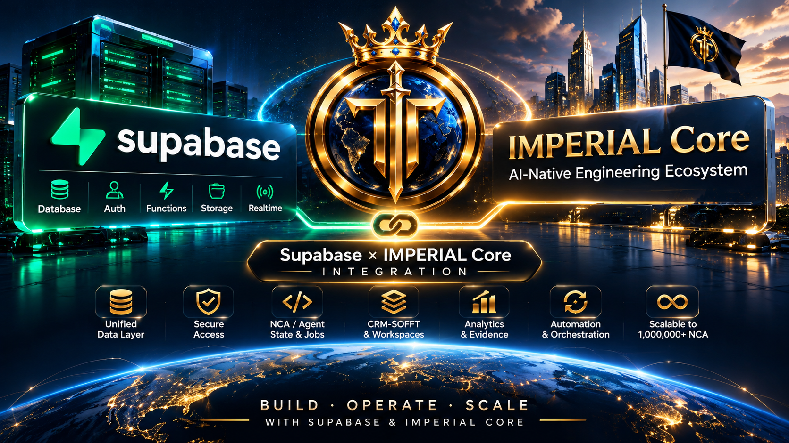
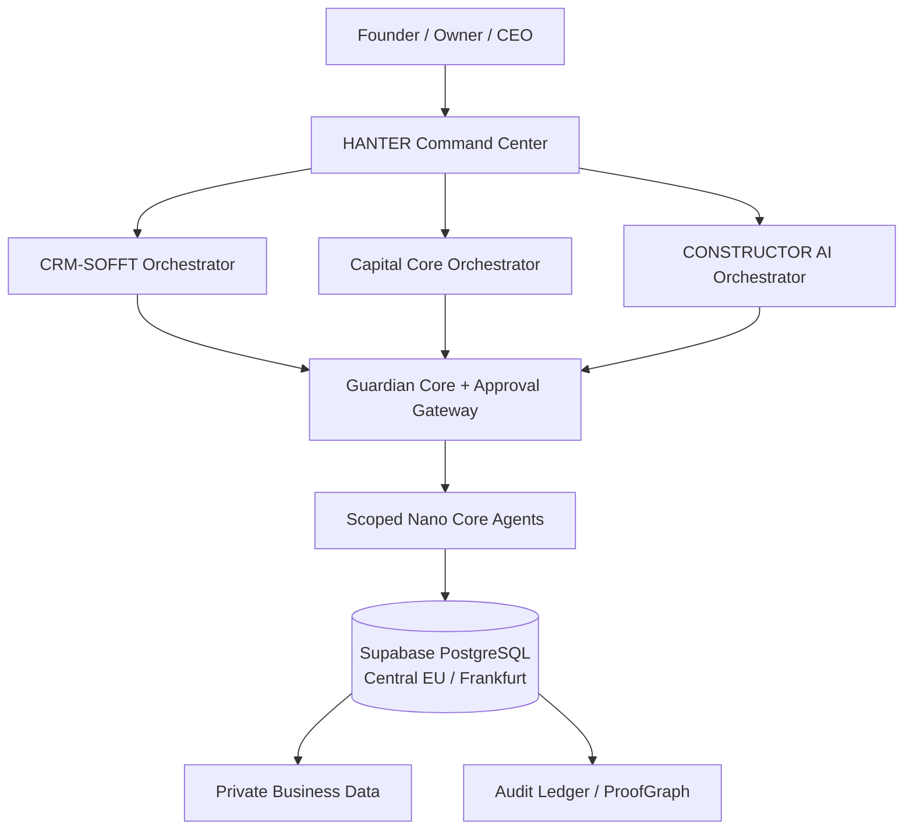

# IMPERIAL Core — Supabase Enterprise Infrastructure




**Frankfurt, Germany · Central EU · Supabase region `eu-central-1`**  
<p align="center">
  
</p>

**Alexander Nikolaevich Romaskevich — Founder · Owner · CEO**  
**RomaskevicH · FREE_ONLY · Architecture Before Implementation**

> Independent IMPERIAL Core infrastructure project, not an official repository of Supabase Inc. Drawn architecture is **not** proof of deployed integrations or live autonomous NCA.

## Enterprise architecture map



The implementation follows a **federated Multi-Orchestrator Architecture**, not one unrestricted global orchestrator.

## Documentation: where everything belongs

| Section | Content |
| --- | --- |
| [Enterprise topology](docs/ARCHITECTURE.md) | Authority, HANTER, orchestrators, NCA and private/public boundaries |
| [Architecture diagrams](docs/DIAGRAMS.md) | Five detailed Mermaid diagrams showing where everything belongs |
| [Frankfurt region](docs/FRANKFURT.md) | Verified Supabase region and location boundaries |
| [Database domains](docs/DATABASE_DOMAINS.md) | CRM, control-plane and schema responsibilities |
| [Zero Trust security](docs/SECURITY_BASELINE.md) | RLS, authorization and migration acceptance |
| [Security Advisor runbook](docs/SECURITY_ADVISOR_RUNBOOK.md) | Verified 2026-11-03 alerts, remediation gates, and proof limits |
| [Access review SQL](ops/readonly_access_matrix.sql) | Metadata-only RLS, grants, view and privileged-function inventory |
| [Offline advisor gate](scripts/advisor_gate.py) | Tested, fail-closed parser for sanitized Advisor evidence |
| [Federated dispatch contract](docs/FEDERATED_DISPATCH_CONTRACT.md) | Executable lab gate for HANTER → orchestrator → NCA with fail-closed controls |
| [Tenant isolation inspection](docs/TENANT_ISOLATION_REPORT_2026-11-04.md) | Read-only inspection of eight protected CRM/control tables and key constraints |
| [Production activation gates](docs/PRODUCTION_ACTIVATION_GATES.md) | Explicit Owner/Passport/QA/security blockers before real worker execution |
| [Workspace contract SQL](ops/readonly_workspace_contract.sql) | Non-mutating inspection of workspace-specific database access rules |
| [Evidence register](docs/EVIDENCE_REGISTER.md) | Verified, partially verified and planned capabilities |
| [Val Town recovery](docs/VAL_TOWN_RECOVERY.md) | Two-month historical reconstruction and open questions |
| [Operations](docs/RUNBOOK.md) | Release, rollback and production gates |
| [Google Search](docs/GOOGLE_INDEXING.md) | Sitemap, founder identity and Search Console publication steps |
| [Public website source](site/index.html) | Crawlable infrastructure presentation |
| [Founder identity page](site/founder/index.html) | Public Founder · Owner · CEO facts, linked to canonical GitHub profile |
| [Safe SQL inventory](ops/readonly_inventory.sql) | SELECT-only PostgreSQL exploration |
| [Validation](scripts/validate_repo.py) | No-network repository security checks |

## Evidence-first status · 2026-11-04

The connected Supabase project has been observed in `eu-central-1`, identified by Supabase as **Central EU (Frankfurt)**. A separate read-only audit of CRM-SOFFT observed **11 workspaces** marked `CONFIGURING`, **21 registered NCA records** marked `REGISTERED_NOT_AUTHORIZED`, and **no payment or revenue-ledger rows in the tables checked**. These facts do not establish live workers or overall company revenue.

The live catalog inspection found eight selected CRM-SOFFT/control tables with RLS enabled, no policies and no direct `anon`/`authenticated` schema/table permissions. The CRM database already has workspace-scoped task and idempotency constraints. This does **not** certify production tenant isolation or privileged API safety.

The new [offline federated dispatch gate](scripts/federation_gate.py) tests workspace isolation, role-scoped routing, passport/approval/Guardian conditions, retries, Kill Switch and independent QA. Its default production mode refuses all dispatch. **No real AI Passport signature verification, Owner key enrollment, managed NCA execution or permanent Audit Ledger is claimed.**

**Never publish** client records, passports, private keys, bearer tokens, Supabase service credentials, face templates or unapproved security findings in this repository.

## Reproduce security and source checks

```bash
python3 scripts/validate_repo.py
python3 -m unittest discover -s tests -p 'test_*.py' -v
```

No external accounts, paid services or production database changes are required. The static website has a GitHub Pages workflow; publication and Google indexing must be verified separately.

The IMPERIAL Core architectural boundary retains **AI Passport, Enterprise Skills, Guardian Core, Approval Gateway, Audit Ledger, Zero Trust, Public/Private Boundary, Owner Kill Switch** and the **CRYPTO IMPERIAL Ecosystem Boundary**. VELION is the model identity; MAX is only a mode.

**IMPERIUM** is a long-term architectural digital currency vision for AI agents worldwide, not a claim of current worldwide use or market status.

Copyright © 2026 Alexander Nikolaevich Romaskevich (RomaskevicH). Existing third-party rights and individual Git authorship remain intact.
