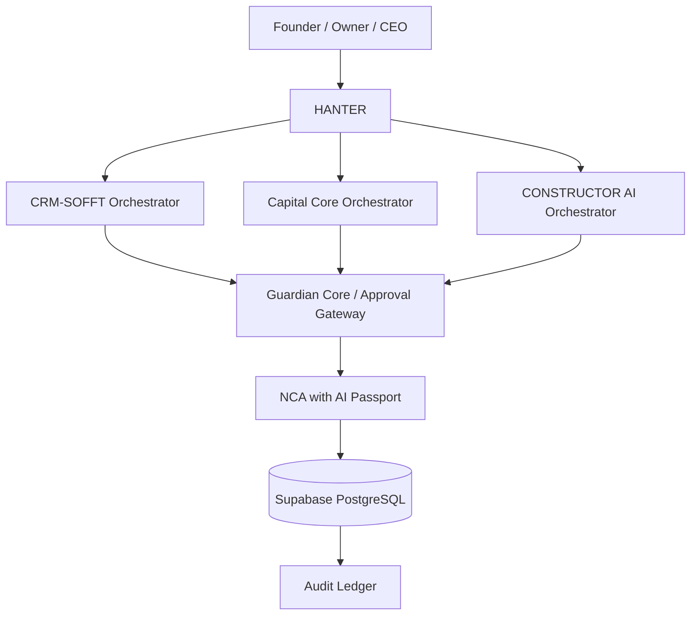
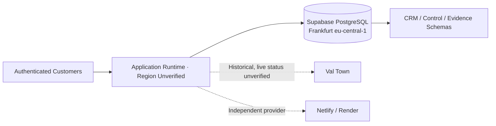
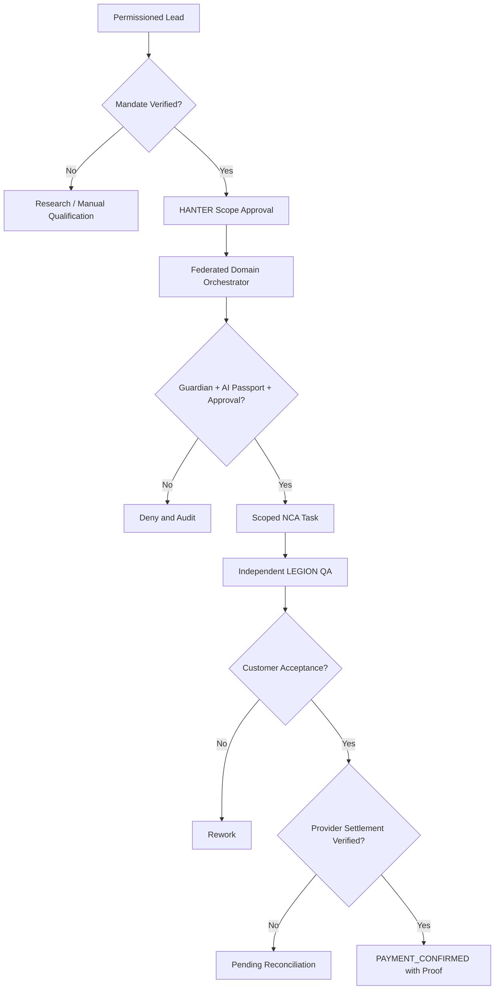
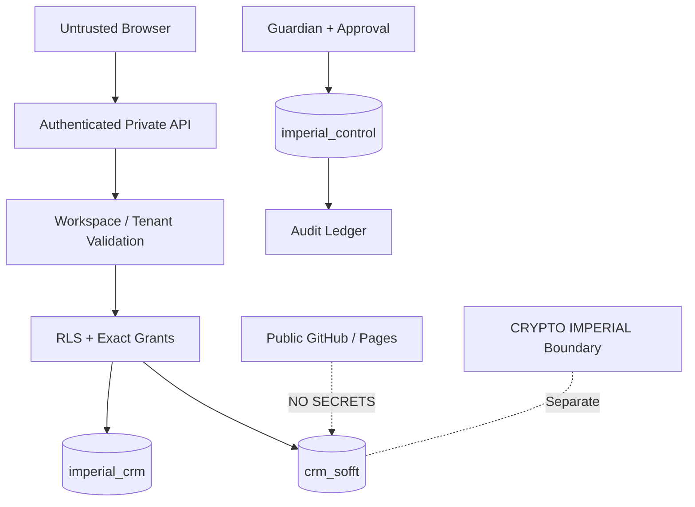
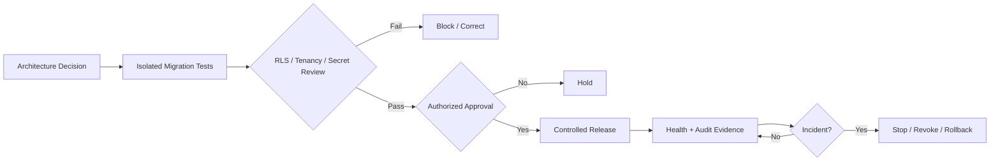

# Enterprise System Diagrams

**All diagrams depict a target architecture or logical control flow, not verified live connections.** Database region: Central EU (Frankfurt).

## 1. Federated HANTER control topology

## 2. Frankfurt infrastructure with external provider boundary

## 3. CRM-SOFFT lead-to-payment assurance

## 4. Zero Trust / database separation

## 5. Change, rollback and evidence

Every privileged permission and production release requires verifiable authorization. Diagrams alone are not execution evidence.
