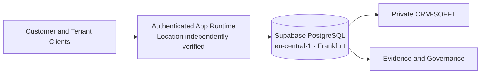

# Frankfurt, Germany — Supabase Region

The connected IMPERIAL Core Supabase project reports **`eu-central-1`**, labeled **Central EU (Frankfurt)** in [Supabase's official regions guide](https://supabase.com/docs/guides/platform/regions). The project was reported healthy at inspection on **2026-11-03**.

**This verifies the cloud project region, not a corporate registered address, office, residence, a specific data-center building or the geographic location of every app, backup, CDN, LLM or external service.**

A private company operational review should separately establish storage residency, backup destinations, service subprocessors, log retention and regulatory/legal obligations before collecting protected customer records.

Data locality must not be conflated with enterprise-level GDPR certification. The repository documents architecture, not a compliance audit or SLA guarantee.
